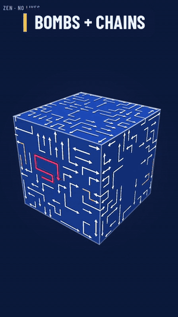

# Changelog

## 1.7.1 (2026-11-13)

- **Plain cubes** (Settings → Look): just the arrows and the cube, with no bombs, locked or two-way arrows, and no wormholes. A level you saved before switching resumes as it was, and the World Cube stays the same for everyone.
- What's new after an update now covers every version since the one you last opened, not just the newest.

## 1.7.0 (2026-11-13)

- **World Cube** (More): one giant cube every Cubit player clears together, live. Each arrow you clear is gone for everyone, and other players' clears fly off your screen as they happen. Whoever frees the pink arrow wins the cube, puts their name on it and starts the next one.
- **Twist mode** (Mode): twist a face and every arrowhead on it turns a quarter turn. Twists are unlimited, so a cube can never get stuck, but each one counts against par.
- **Special arrows** on cubes from 11×11 up: **bombs** (orange core) take every arrow touching them along and set off the bombs they catch in a chain reaction; **locked arrows** (dashed core) wait until their key arrow has gone, and tapping one early points out its key; **two-way arrows** (a head at each end) leave tail first when the head's way is blocked. Daily, weekly and Nightmare cubes stay as they were.
- **Wormholes**: pairs of portals straight through the cube from each other. A way out that reaches one carries on from the other side.
- **Endless** (More): cube after cube, each a little bigger, with your lives carrying over. Between cubes, pick a life, 15 seconds or a hint. **Today's endless** is the same run of cubes for everyone, and Rankings has an Endless tab for today's and all-time best runs, each cube checked by the server.
- **Past daily cubes** (More): a calendar of every daily cube since the first. Play any you missed (it doesn't touch your streak) and race that day's leader as a ghost.
- **Name cubes** (More): any name makes a cube, the same for everyone who types it. Share it to dare a friend.
- **Public profile** (Settings, off by default): a page you can share with your level, badges, streak and best runs. There's no account behind it: it hangs off your friend code, and switching it off takes it down.
- **Combos and arrow preview**: quick clears with no bump count up a combo over the cube, and holding an arrow shows its way out, green when clear and red when blocked. The pink arrow glows once its way out is clear.
- **Backup code** (Settings → Progress): copy one code to move your progress, settings and place on the board to a new phone.
- **A new More and Rankings**: More is three tabs of cards (Today, Together, Your way) that fit without scrolling. Rankings has five tabs, a podium for the top three, roomier rows with your own lit up, and anyone with a public profile opens it with a tap.
- New badges: Demolition, Chain reaction, End of the line and Every day this month.
- A music volume slider, and the music now loops without a gap.
- The screen turns with your phone, and menus keep a readable width on tablets.
- The screen stays on during a level.
- Rankings shows how many players are on the board.
- Turning the cube follows your finger the same on every screen size and when zoomed in.
- Names with slurs are kept off the board.
- After an update, Cubit shows what's new (this list), once. Settings → About → What's new brings it back. Players from before 1.7 are asked once whether to switch on the online features; "Not now" is final.
- Fixed: settings that redraw the page (colourway, arrow colour, high contrast) jumped back to the top.

## 1.6.1 (2026-11-05)

- Cubit is by Tay März ([taymaerz.de](https://taymaerz.de)): the credit in Settings now says so and opens the site, and About has a "Made by Tay März" link.

## 1.6.0 (2026-11-05)

- **Friends** (Rankings → Friends): swap 8-character friend codes and see each other's level, XP and best run side by side.
- **Challenge a friend**: the share text after a win carries a link that opens the same cube with your run as a ghost to race.
- **My pack**: save cubes you've won from the win sheet, and share the pack as a link. Shared packs land in More → Puzzle packs.
- **Replay controls**: pause, 2× speed and a scrub bar.
- **Stats** (tap your name on Play): wins, losses, best and average times per mode, and a five-week calendar of daily solves.
- **Streak freezes**: finishing a weekly challenge earns one (hold up to two), and each covers one missed daily cube.
- **Race your best**: replay a cube you've won before and your best run on it comes along as a ghost.
- Your best daily score shows under More → Daily cube.
- **High contrast** (Settings → Accessibility): a black-and-white colourway with line colours that stay distinct for colour-blind players.
- Fixed: replaying a solved daily cube gave a bonus hint every time; Zen and Clean replays ignored take-backs; a saved pack level didn't count towards its pack; the streak reminder stopped after a reboot; "See badges" opened the Daily tab; big cubes could freeze the screen while building; one-letter names couldn't join the rankings; full-clear replays let the pink arrow out early; leaving a level before clearing anything kept an empty saved level.
- New permission, "run at startup": used only to set the streak reminder again after a reboot.

## 1.5.0 (2026-11-04)

- **Nightmare mode** (Mode on the Play tab): arrows run a full lap round the cube before they leave, so you have to check every face they pass, back faces included. One life, a tight timer, no hints, no powerups, ×3.5 XP. A new badge, Night shift, for your first win.
- Rankings say "Player LV" for the level from XP, and each tab keeps its own subtitle.
- After a run, Global rank shows where you stand on the board even when it wasn't your best run.

## 1.4.1.1 (2026-11-03)

- Fixed the cube sometimes zooming when you tapped and then dragged to turn it. Only a two-finger pinch zooms now.
- Lifting one finger after a pinch no longer jerks the cube round.
- Flicking the cube spins the same on every phone, and it no longer flings if your finger stopped before lifting.
- Tapping to stop a spinning cube no longer removes an arrow by accident.
- Find next resets zoom and pan, so the face it turns to stays on screen.

## 1.4.1 (2026-11-03)

- Support links (Ko-fi and GitHub Sponsors) in Settings, About, and on the website.

## 1.4.0 (2026-11-02)

- **New app ID: `de.taymaerz.cubit`** (it was `com.cubit.game`). Android treats this as a new app, so it installs next to the old one rather than over it. Install 1.4.0, then uninstall the old Cubit. Progress on the old install doesn't carry over, and with rankings on you'll join the board as a new player.

## 1.3.1 (2026-11-02)

- A separate F-Droid build without the GitHub update check. Builds are now reproducible, and releases carry both `Cubit.apk` and `Cubit-fdroid.apk`.
- Get automatic updates from GitHub with Obtainium (links on the website and in the README).

## 1.3.0 (2026-11-02)

- **Weekly challenge:** one 16×16 cube for everyone, Monday to Sunday, with its own board (Rankings → Week).
- **Puzzle packs:** Pocket, Needlework, Long lines and Monster, with ten cubes each, picked for how deep the pink arrow sits.
- **Par:** every cube has a fewest-taps-to-win number. Matching it counts as on par, and there's a badge for it.
- **Ghost race:** on the daily and weekly cubes, the leader's recorded run plays on your cube by the same clock, and its cleared arrows fade.
- **Colourways you earn:** six of the twelve open with badges. There are three new badges: On par, Weekender and Collector.
- **Streak reminder (opt-in):** one notification around 7 pm if your daily streak would end tonight.
- **Share links** to the daily or weekly cube open that cube in Cubit, or the download page if the friend doesn't have it.
- **Update notices:** a small card on the Play screen when a new version is out. It can be switched off in About.
- **Yesterday's cube:** a one-time card with how you placed.

## 1.2.0 (2026-11-02)

- Settings has an About section with the version, an update check against GitHub releases, and links to the website, source and changelog. The version also sits at the bottom of Settings.
- The website shows the current version, read live from the latest release.

## 1.1.1 (2026-11-02)

- Proper adaptive app icon: the navy ground fills whatever shape your launcher uses, with no more small square on a white circle. Android 13+ themed icons get a line-art version of the cube.
- The launch screens use the same cube.

## 1.1.0 (2026-11-02)

- Opening screen: a small cube spins in, CUBIT clatters onto the split-flap board, and the tagline fades up. A tap skips it, and it's skipped when animations are turned off.
- Launch screen: the app opens on its navy ground with the icon, using Android 12's own splash screen where available, so there's no white flash.
- Loading board: if a big cube takes more than a moment to build, a LOADING board covers the wait.

## 1.0.0 (2026-11-02)

The first release.

- An endless campaign. Cubes start at 10×10 per side with about 100 winding arrows and grow to 18×18, and the pink arrow is buried deeper as levels go on.
- Clean mode, one tap from the home screen: a see-through glass cube in your colourway, with no HUD. Two-finger tap takes back a move.
- Modes Zen, Easy, Normal, Hard and Expert, plus an optional Full clear goal (every arrow off, pink last).
- A daily cube with its own board and a streak, free roam (2×2 to 18×18) and level replays.
- Powerups Scan, Shield, Freeze, Spare life and Undo, each switchable. Hints are earned for levelling up, perfect runs and daily cubes.
- Leaving a level saves it, and the save survives the app closing.
- A first-launch tutorial and setup.
- Optional global rankings: players, best runs and today's daily cube. Every ranked run is replayed and verified by the server, and runs can be watched back.
- Badges, XP, a share card, 12 colourways, haptics, sound effects and a synthesized soundtrack.
- Accessibility: a striped target, a left-handed layout, heavier arrows, and support for the system's Remove animations setting.
- Signed with the release key. Earlier test builds must be uninstalled once.
