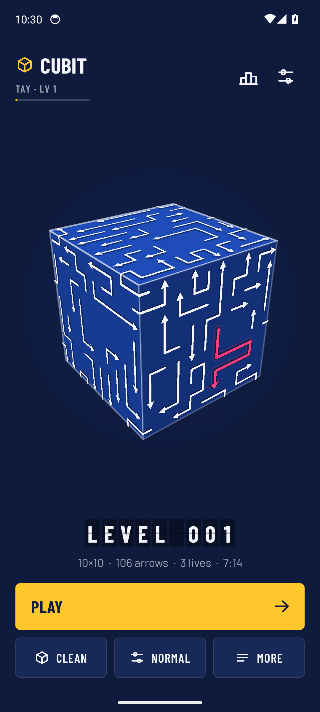
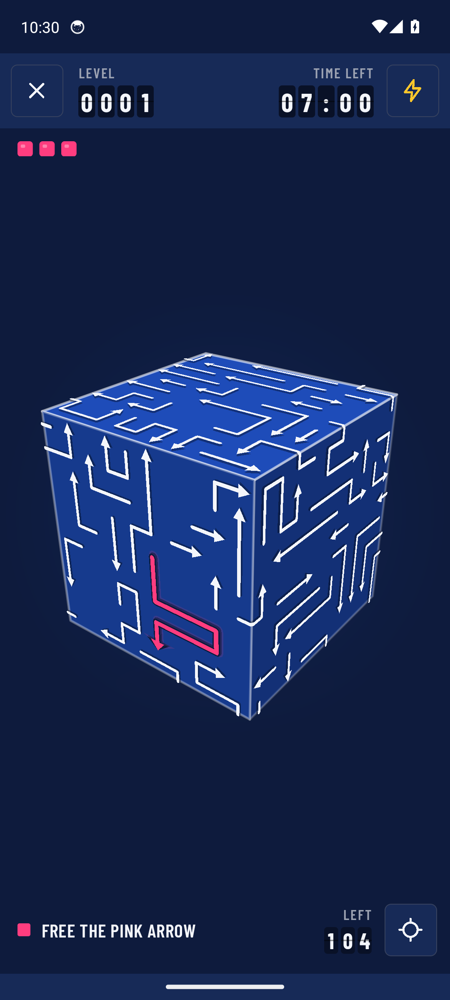
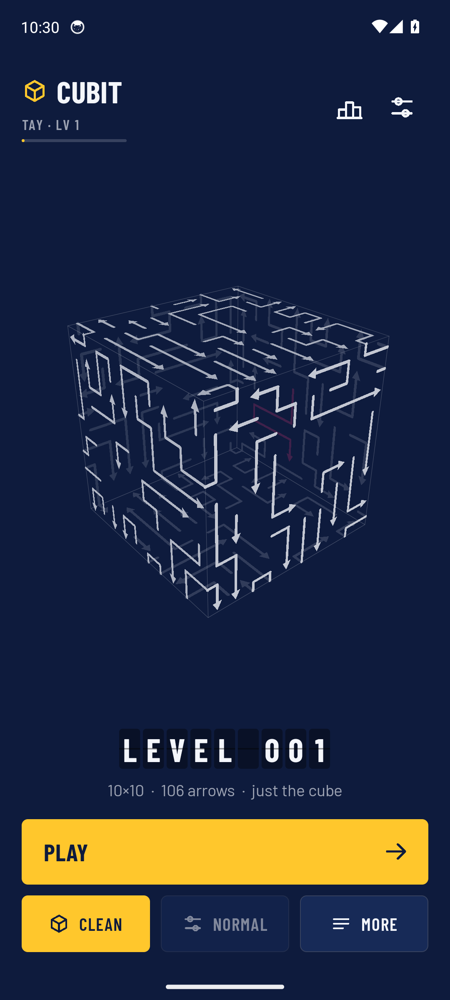
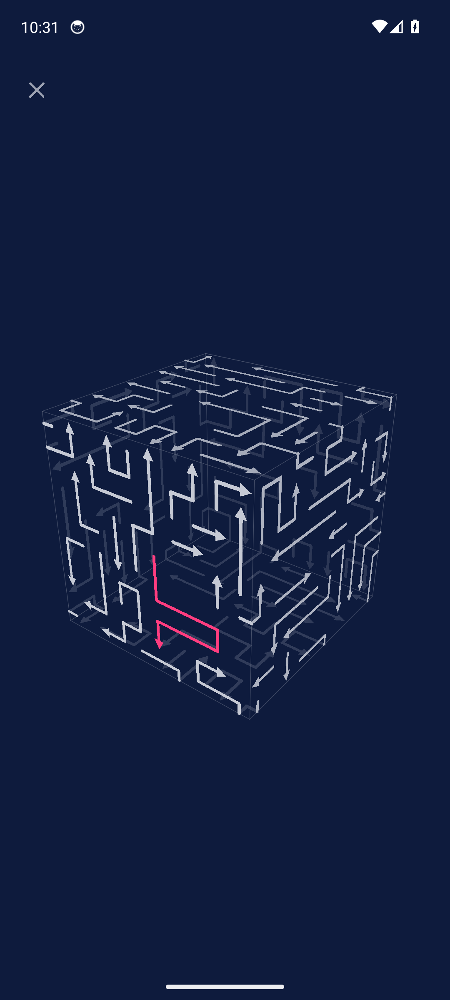

<p align="center"></p>

<h1 align="center">Cubit</h1>

<p align="center"><b>A hard little cube of arrows. Free the pink one.</b><br>
No ads, no accounts, no nonsense. Native Android.</p>

<p align="center">
  <a href="https://github.com/taynotfound/cubit/releases/latest/download/Cubit.apk"><b>Download the APK</b></a> ·
  <a href="https://taynotfound.github.io/cubit/">Website</a> ·
  <a href="https://github.com/taynotfound/cubit/releases">All releases</a>
</p>

<p align="center">
  
  
  
  
</p>

## How it plays

Every face of the cube is covered in arrows. Tap one and it slides forward along its path and off the cube, if nothing is in the way. If something is, it bumps and bounces back, and on most modes that costs a life.

One arrow is pink. **Clear a way out for it and tap it to win.** Drag to turn the cube, pinch to zoom, two fingers to pan.

Levels start at 10×10 per side with about a hundred winding arrows and grow to 18×18. The pink arrow is always buried: the generator rerolls a level until enough arrows stand in its way, and that depth rises as you go.

## Features

- **Clean mode.** One tap on the home screen. Just a see-through glass cube in your colours, back faces showing through, no lives, no timer, no buttons. Two-finger tap to take back a move.
- **Modes:** Zen, Easy, Normal, Hard and Expert, each with its own lives, timer and XP multiplier.
- **Full clear.** An optional goal: clear every arrow, and the pink one has to leave last.
- **Endless campaign, a daily cube, free roam** (any size from 2×2 to 18×18) and replays of any level.
- **Powerups,** each switchable: Scan, Shield, Freeze, Spare life and Undo. Hints are earned for levelling up, perfect runs and daily cubes.
- **Leaving is safe.** Leave a level and it's saved; continue it from the home screen.
- **Global rankings** (optional). Every ranked run is verified on the server by replaying your taps, so scores can't simply be posted. There are boards for players, best runs and today's daily cube, and you can watch any run back.
- **Badges, XP and a daily streak.**
- **12 colourways** with arrow colour and weight options. Sound effects, a small synthesized soundtrack and real haptics.
- **Accessibility:** a striped target that doesn't rely on colour, a left-handed layout and arrows up to weight 14. It follows the system's Remove animations setting.
- **A share card** for your best runs.

## Install

Download `Cubit.apk` from the [latest release](https://github.com/taynotfound/cubit/releases/latest) and open it on your phone. Android 7.0 or newer.

> Upgrading from a build before 1.0.0? Those were signed with a development key. Uninstall the old app first; 1.0.0 and later update in place.

**GrapheneOS and other privacy ROMs:** if rankings say "can't reach the internet", allow Cubit's Network permission. The app works fully offline otherwise.

## Build it yourself

You need JDK 17 and the Android SDK (platform 34).

```bash
./gradlew testDebugUnitTest assembleRelease
```

The APK lands in `app/build/outputs/apk/release/`. Release builds are signed from `keystore.properties` (`storeFile`, `storePassword`, `keyAlias`, `keyPassword`). Without it they fall back to the debug key.

The app is plain Kotlin with no AndroidX: Activities, programmatic Views and a hand-rolled perspective renderer on Canvas.

## Leaderboard server

`server/` is a small Go service with no dependencies. It regenerates each cube from its seed (`puzzle.go` is a bit-identical port of `Puzzle.kt`, pinned by fingerprint tests on both sides), replays every ranked run, computes the score itself, and holds suspicious runs for review. It saves to disk atomically and keeps daily backups. See [server/README.md](server/README.md).

```bash
cd server && go test ./... && CGO_ENABLED=0 go build -trimpath -ldflags="-s -w" -o cubit-leaderboard .
```

## Project layout

| Path | What |
|---|---|
| `app/src/main/java/com/cubit/game/Puzzle.kt` | Cube geometry, deterministic level generator |
| `GameView.kt` | Renderer, camera, input, rules |
| `MainActivity.kt` | Screens, sheets, rounds, saving |
| `Ui.kt`, `Sfx.kt`, `Net.kt`, `Prefs.kt` | Design kit, sound and haptics, rankings client, settings |
| `server/` | Leaderboard and run verification |
| `tools/` | Scripts that synthesize the swoosh and the music |
| `DESIGN.md` | The Wayfinding design system |
| `docs/` | The website (GitHub Pages) |

## Credits

- Fonts: [Barlow](https://github.com/jpt/barlow) by Jeremy Tribby, under the SIL Open Font License.
- Sound effects: [Kenney](https://kenney.nl) packs, CC0. The split-flap clacks were cut from a real display recording, and the swoosh and the music are synthesized by the scripts in `tools/`.
